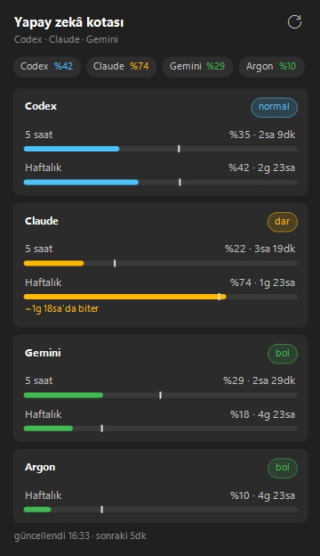

Türkçe: [README.tr.md](README.tr.md)

# ai-kota

A Windows system tray icon and popup panel that displays subscription quotas for AI coding agents in one place.



## Features

- **Supported agents:** OpenAI Codex CLI, Google Antigravity CLI (`agy`: Gemini group, Argon, Claude/GPT group inside `agy`), and Claude Code (optional).
- **Tray icon:** Ring indicator filled by the most critical family's usage percentage and colored by status label (green for plenty, blue for normal, yellow for tight, red for full), with a summary tooltip on hover.
- **Popup panel:** Dark Windows 11-style rounded panel with a card per provider, 5-hour and weekly window bars, pacing marker (elapsed fraction of the window), depletion estimate (such as `~20sa 50dk'da biter` when current pace would exhaust quota before reset), time remaining until reset, and stale/error states.
- **Right-click menu:** Refresh now (`Şimdi yenile`), start with Windows (`Windows açılışında başlat`), and Exit (`Çık`). The UI language is currently Turkish.
- **CLI collector:** `kota.py` (Python 3.10+, standard library only) works as both a collector and a terminal table view.
- **Low resource usage:** ~0% idle CPU (watches file changes and refreshes every 5 minutes) and ~57 MB memory.

## Privacy

- No secret login tokens or credential files are read (`~/.claude/.credentials.json` and `~/.codex/auth.json` are never read).
- No network requests are made.
- Reads only local session logs, local `agy` CLI output, or a user-provided `claude.json` file.

## Installation

### Option A: Prebuilt Release

1. Download `ai-kota-vX.zip` from GitHub Releases and extract it to a folder.
2. Keep `KotaTepsi.exe` and `kota.py` in the same folder or in parent folders (otherwise set the `KOTA_PY` environment variable).
3. Install **.NET 9 Desktop Runtime** and ensure **Python 3.10+** is on `PATH` as `python.exe`.
4. Run `KotaTepsi.exe`. The icon may be under the hidden icons (`^`) area; drag it onto the taskbar.

### Option B: From Source

Requires .NET 9 SDK and Python 3.10+.

```powershell
git clone https://github.com/MehmetKoc16/ai-kota.git
cd ai-kota/tepsi
dotnet build -c Release
dotnet run
```

Tests:

```powershell
# From the root folder
python -m unittest test_kota

# C# tests
cd tepsi/tepsi.Tests
dotnet test
```

## Usage

Run `KotaTepsi.exe` for the tray app, or run `kota.py` directly:

- `python kota.py` — display the quota table
- `python kota.py --json` — print output as JSON
- `python kota.py --yaz` — write to file only
- `python kota.py --claude-dosyasi <path>` — import `claude.json`

The data directory is `%LOCALAPPDATA%\kota\` (configurable via `KOTA_DIZIN`). The output file is `kota.json`; its format is documented in [SOZLESME.md](SOZLESME.md).

## How It Works

`kota.py` collects quota state into `kota.json`, and the C# .NET 9 WinForms application under `tepsi/` (`KotaTepsi.exe`) renders the tray icon and panel.

| Provider | Data Source | Notes |
| --- | --- | --- |
| OpenAI Codex CLI | Latest `rate_limits` record in `~/.codex/sessions/**/*.jsonl` | Updates only while Codex runs |
| Google Antigravity CLI (`agy`) | `agy -p "/usage" --output-format json` | 120-second cache |
| Claude Code (optional) | `claude.json` in the data directory | Written by the user or an automation script using the Claude Code desktop app usage card window format (`label`, `percentUsed`, `resetsAt`). When missing, the Claude card shows `claude.json yok` |

To collect Claude Code statusLine quotas, add this to `~/.claude/settings.json` (replace the path):

```json
"statusLine": {"type": "command", "command": "python C:/path/to/claude_durum_satiri.py"}
```

It updates only while a Claude Code session is open; the Fable-specific weekly limit is not available from this source.

## Limitations

- Windows 10/11 only.
- Codex data is only as current as the latest Codex session.
- No automatic reading for Claude.
- Percentages are the providers' own estimates.
- Unofficial tool; not affiliated with OpenAI, Google, or Anthropic.

## License

MIT — see [LICENSE](LICENSE).
