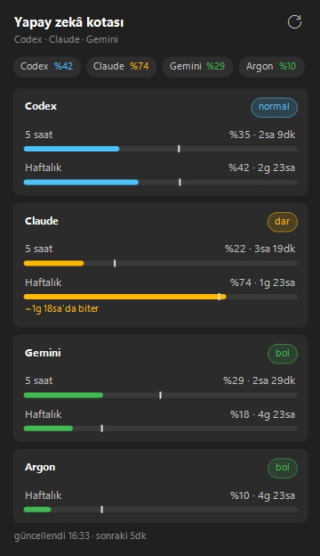

English: [README.md](README.md)

# ai-kota

Yapay zekâ kodlama ajanlarının abonelik kotalarını tek yerde gösteren Windows sistem tepsisi simgesi ve açılır panel.



## Özellikler

- **Desteklenen ajanlar:** OpenAI Codex CLI, Google Antigravity CLI (`agy`: Gemini grubu, Argon, `agy` içindeki Claude/GPT grubu) ve Claude Code (isteğe bağlı).
- **Simge:** En kritik ailenin kullanım yüzdesi kadar dolan halka; rengi etikete göre değişir (bol yeşil, normal mavi, dar sarı, dolu kırmızı). Üzerine gelince özet ipucu gösterir.
- **Panel:** Windows 11 tarzı koyu, yuvarlak köşeli. Her sağlayıcı için kart; 5 saatlik ve haftalık pencere çubukları; tempo işareti (pencerenin geçen kısmı); bu hızla sıfırlanmadan önce bitecekse `"~20sa 50dk'da biter"` tahmini; sıfırlanmaya kalan süre; bayat/hata durumu.
- **Sağ tık menüsü:** Şimdi yenile, Windows açılışında başlat, Çık. Arayüz dili şu an Türkçedir.
- **Komut satırı toplayıcısı:** `kota.py` (Python 3.10+, yalnız standart kütüphane) toplayıcı ve komut satırı tablosu olarak çalışır.
- **Kaynak tüketimi:** Boşta CPU ~0 (dosya değişikliği izlenir, 5 dakikada bir yenileme), ~57 MB bellek.

## Gizlilik

- Hiçbir gizli giriş belirteci veya kimlik dosyası okunmaz (`~/.claude/.credentials.json`, `~/.codex/auth.json` okunmaz).
- Ağ isteği yapılmaz.
- Yalnız yerel oturum günlüklerini, yerel `agy` çıktısını veya kullanıcının sağladığı `claude.json` dosyasını okur.

## Kurulum

### Kurulum A: Hazır Sürüm

1. GitHub Releases'ten `ai-kota-vX.zip` dosyasını indirin ve bir klasöre açın.
2. `KotaTepsi.exe` ve `kota.py` aynı klasörde ya da üst klasörlerde olmalıdır; değilse `KOTA_PY` ortam değişkenini ayarlayın.
3. **.NET 9 Desktop Runtime** gereklidir; **Python 3.10+** `PATH` içinde `python.exe` olarak bulunmalıdır.
4. `KotaTepsi.exe`'yi çalıştırın. Simge gizli simgeler (`^`) altında olabilir; görev çubuğuna sürükleyin.

### Kurulum B: Kaynaktan

.NET 9 SDK ve Python 3.10+ gerektirir.

```powershell
git clone https://github.com/MehmetKoc16/ai-kota.git
cd ai-kota/tepsi
dotnet build -c Release
dotnet run
```

Testler:

```powershell
# Kök klasörde
python -m unittest test_kota

# C# testleri
cd tepsi/tepsi.Tests
dotnet test
```

## Kullanım

Sistem tepsisi uygulaması için `KotaTepsi.exe`'yi çalıştırın veya komut satırından `kota.py`'yi kullanın:

- `python kota.py` — kota tablosunu gösterir
- `python kota.py --json` — JSON çıktısı verir
- `python kota.py --yaz` — yalnızca dosyaya yazar
- `python kota.py --claude-dosyasi <yol>` — `claude.json` dosyasını içeri alır

Veri klasörü `%LOCALAPPDATA%\kota\` konumundadır (`KOTA_DIZIN` ile değişir). Çıktı `kota.json` dosyasıdır; biçimi [SOZLESME.md](SOZLESME.md) dosyasında yer alır.

## Nasıl çalışır

`kota.py` verileri toplayıp `kota.json` dosyasına yazar; `tepsi/` altındaki C# .NET 9 WinForms uygulaması (`KotaTepsi.exe`) simgeyi ve paneli gösterir.

| Sağlayıcı | Veri Kaynağı | Notlar |
| --- | --- | --- |
| OpenAI Codex CLI | `~/.codex/sessions/**/*.jsonl` içindeki son `rate_limits` kaydı | Yalnız Codex çalıştıkça güncellenir |
| Google Antigravity CLI (`agy`) | `agy -p "/usage" --output-format json` | 120 sn önbellek |
| Claude Code (isteğe bağlı) | Veri klasöründeki `claude.json` | Kullanıcı ya da bir otomasyon yazar; biçim Claude Code masaüstü uygulamasının kullanım kartındaki pencerelerdir (`label`, `percentUsed`, `resetsAt`). `claude.json` yoksa Claude kartı `claude.json yok` der |

## Sınırlamalar

- Yalnız Windows 10/11 desteklenir.
- Codex verisi en son Codex oturumu kadar günceldir.
- Claude için otomatik okuma yoktur.
- Yüzdeler sağlayıcıların kendi tahminleridir.
- Resmî olmayan bir araçtır; OpenAI, Google veya Anthropic ile ilişkisi yoktur.

## Lisans

MIT — ayrıntılar için [LICENSE](LICENSE) dosyasına bakın.
